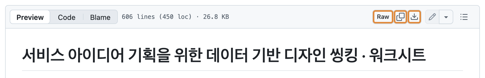
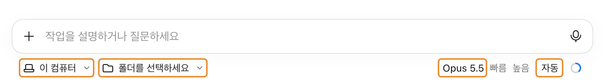

# 작업 폴더와 워크시트 저장소 준비 가이드

교재: 1.1절 이틀간의 과목 흐름 (9쪽) · 부록 A-1 작업 폴더와 비공개 저장소 (41~42쪽) · 쓰는 날: Day 1 오전, 그리고 하루를 마칠 때마다 · 쓰는 곳: GitHub 비공개 저장소 `design-thinking-worksheet`와 내 컴퓨터의 작업 폴더 `design-thinking-worksheet/`

## 이 가이드에서 볼 것

이틀 동안의 결과물은 두 곳에 둡니다. 수업 중에는 내 컴퓨터의 **작업 폴더**에서 일하고, 하루를 마칠 때마다 GitHub의 **비공개 저장소**에 올립니다. 이 가이드는 교재 1.1절 [실습 안내]와 부록 A-1의 흐름을 실제 화면의 버튼 이름과 위치로 따라갑니다. 두 곳을 처음 한 번 만드는 순서와, 작업 폴더의 파일을 저장소에 올리는 순서를 다룹니다.

- Git 명령(개발자가 터미널에서 쓰는 명령)은 쓰지 않고 github.com 웹 화면에서만 작업합니다.
- Mac과 Windows의 GitHub 화면은 같고 단축키만 다릅니다(Mac `Cmd` = Windows `Ctrl`).

## 두 곳 한눈에

| | 작업 폴더 | 워크시트 저장소 |
|---|---|---|
| 어디에 | 내 컴퓨터 (바탕화면이나 문서 폴더) | github.com 내 계정 |
| 이름 | `design-thinking-worksheet/` | `design-thinking-worksheet` (**Private**) |
| 무엇을 | Claude Code가 이 폴더를 열고 파일을 만들고 고칩니다. `worksheet.md`도 여기서 채웁니다 | 하루를 마칠 때마다 작업 폴더의 파일을 올려 두는 곳. 강사 `wild-mental`이 봅니다 |

작업 폴더 안의 모양입니다(교재 부록 A-1, 지시문 킷과 같음).

```text
design-thinking-worksheet/
├── worksheet.md                  ← 자료실 원본의 워크시트를 복사한 것
├── DESIGN.md                     ← (선택) 앞 과목에서 만든 나만의 DESIGN.md 사본 (2.4)
├── research/
│   ├── status-report.md          ← 현황 분석 리서치 (1.3)
│   ├── stakeholders.md           ← 이해관계자 분석 (1.3)
│   ├── market-tam-sam.md         ← TAM·SAM (1.6)
│   ├── causes-hypotheses.md      ← 핵심 원인과 가설 (1.7)
│   ├── segment-map.md            ← 세그먼트 맵 (2.2)
│   └── solution-som.md           ← 솔루션 정의와 SOM (2.3)
├── prototype/
│   └── concept-prototype.html    ← 개념 프로토타입 (2.4)
└── interviews/
    ├── persona-cards.md          ← 인터뷰 대상 페르소나 카드 (2.5)
    ├── interview-plan.md         ← JTBD 인터뷰 계획서 (2.5)
    ├── pair-interview-notes.md   ← 짝 롤플레잉 기록 (2.6, 직접 씀)
    ├── virtual-interviews.md     ← AI 가상 인터뷰 기록 (2.7)
    └── interview-report.md       ← 결과 보고서 · 요약 카드 · 고용·해고 여정 (2.7)
```

폴더와 파일 이름은 모두 영문 소문자로, 위와 똑같이 씁니다. 지시문 킷의 지시문이 이 이름으로 파일을 찾습니다.

**`worksheet.md`는 작업 폴더에서만 고칩니다.** 저장소는 하루를 마칠 때 올려 두는 곳입니다. GitHub 웹 화면에서 `worksheet.md`를 고치면, 저녁에 작업 폴더의 `worksheet.md`를 올릴 때 이름이 같아 그 고친 내용이 덮여 사라집니다. 저장소에서 파일을 열었을 때 보이는 연필 아이콘(파일 고치기)은 누르지 않습니다.

## 1. 비공개 저장소 만들기 (처음 한 번)

1. github.com에 로그인하고 오른쪽 위 **+** 단추 → **New repository**를 누릅니다.
2. **Repository name**에 `design-thinking-worksheet`를 씁니다. 공개 범위 선택에서 반드시 **Private**(비공개)를 고릅니다. README 추가 같은 나머지 선택 항목은 건드리지 않고 **Create repository**를 누릅니다.
3. 새 탭에서 워크시트 원본을 엽니다. 자료실 첫 화면의 워크시트 링크를 누르거나 여기 [`worksheet.md` 원본](https://github.com/wild-mental/ax-wave-design-thinking-wildmental/blob/main/worksheet-template/worksheet.md)을 누르면 **자료실 원본**(GitHub 화면)에서 열립니다. 파일 내용 위쪽 막대 오른쪽의 **Copy raw file**(네모 두 개가 겹친 복사 아이콘)을 누릅니다. 눈에 띄는 변화가 없어도 내용 전체가 복사된 것입니다.



주황색 테두리 셋은 왼쪽부터 **Raw**(꾸밈 없이 글만 보는 화면) · **Copy raw file**(전체 복사) · **Download raw file**(파일로 내려받기)입니다. 뒤의 둘은 아이콘만 있으므로 위치로 찾습니다. 그 오른쪽의 연필 아이콘은 누르지 않습니다. 이 버튼들은 github.com 화면에만 있고, 자료실(`wild-mental.github.io`) 화면에는 없습니다.

4. 내 저장소 탭으로 돌아옵니다. 방금 만든 빈 저장소라면 안내 문구 가운데 **creating a new file** 링크를, 이미 파일이 있다면 **Add file → Create new file**을 누릅니다.
5. 위쪽 이름 칸에 `worksheet.md`를 씁니다. 아래 편집 칸을 한 번 누르고 `Cmd+V`(Windows `Ctrl+V`)로 붙여 넣습니다.
6. 오른쪽 위 **Commit changes...** → 뜨는 상자에서 **Commit changes**를 누릅니다. 저장소 첫 화면에 `worksheet.md`가 보이면 됩니다.

## 2. 강사 초대

1. 내 저장소 위쪽 탭의 **Settings**를 누릅니다. 창이 좁으면 탭 줄 끝의 **⋯** 안에 있습니다.
2. 왼쪽 메뉴 Access 아래 **Collaborators**를 누르고 **Add people**을 누릅니다. 비밀번호나 인증을 다시 물으면 입력합니다.
3. 검색 칸에 `wild-mental`을 쓰고, 목록에서 아이디가 정확히 `wild-mental`인 항목을 고른 뒤 **Add wild-mental to this repository**를 누릅니다.

목록에 `wild-mental`이 **Pending invite**(수락 대기)로 보이면 여러분이 할 일은 끝났습니다. 강사가 수락하면 대기 표시가 사라집니다.

## 3. 작업 폴더 만들기

1. 바탕화면이나 문서 폴더에 `design-thinking-worksheet` 폴더를 만듭니다. 사전 안내 5번에서 미리 만들어 두었다면 그 폴더를 씁니다.
2. 파일 확장자가 보이게 설정합니다. 그래야 `worksheet.md.txt`처럼 잘못 붙은 이름을 알아챌 수 있습니다.
3. 내 저장소에서 `worksheet.md`를 눌러 열고, 파일 위쪽 막대의 **Download raw file**(내려받기 아이콘, 위 그림의 오른쪽 테두리)을 누릅니다.
4. 내려받은 파일은 보통 **다운로드** 폴더에 저장됩니다. 그 파일을 `design-thinking-worksheet` 폴더로 끌어다 놓아 옮깁니다.
5. 폴더 안의 파일 이름이 정확히 `worksheet.md`인지 봅니다. `worksheet (1).md`나 `worksheet.md.txt`처럼 되어 있으면 이름을 고칩니다.

| | Mac | Windows |
|---|---|---|
| 새 폴더 | Finder에서 바탕화면을 열고 **파일 → 새로운 폴더**(`Cmd+Shift+N`) | 파일 탐색기에서 바탕화면을 열고 빈 곳 오른쪽 클릭 → **새로 만들기 → 폴더**(`Ctrl+Shift+N`) |
| 이름 바꾸기 | 폴더나 파일을 고르고 `Return` | 폴더나 파일을 고르고 `F2` |
| 확장자 보이게 하기 | **Finder → 설정 → 고급 → 모든 파일 확장자 보기** 켜기 | 파일 탐색기 **보기 → 표시 → 파일 이름 확장명** 켜기 |
| 내려받은 파일 찾기 | Finder 왼쪽 목록의 **다운로드** | 파일 탐색기 왼쪽 목록의 **다운로드** |

## 4. Claude Code에서 작업 폴더 열고 하위 폴더 만들기

1. Claude 데스크톱 앱을 열고 위쪽의 **Code** 탭을 누릅니다.
2. 입력창 아래 줄을 봅니다. 왼쪽에 **환경 선택**(처음에는 '이 컴퓨터')과 **폴더 선택**(처음에는 '폴더를 선택하세요')이 있고, 오른쪽에 모델 이름이 보이는 **모델 선택**과 **모드 선택**이 있습니다.



3. **환경 선택**에서 내 컴퓨터(**이 컴퓨터**)를 고릅니다.
4. **폴더 선택**을 누르고 `design-thinking-worksheet` 폴더를 고릅니다. 하위 폴더가 아니라 맨 위 폴더를 고릅니다. Mac에서 Claude가 '데스크탑'(또는 '문서') 폴더의 파일에 접근하려 한다는 창이 뜨면 **허용**을 누릅니다.
5. **모드 선택**은 앞 과목에서 쓰던 대로 둡니다. 처음이라면 파일을 만들거나 고치기 전에 허락을 묻는 모드를 고릅니다. **모델 선택**은 기본 모델 그대로 둡니다. 빠른 응답용 · 경량 모델로 바꾸지 않습니다.
6. 지시문 킷의 「[작업 폴더 준비 지시문](../kits/claude-code-research-prompts.md)」 코드 상자 안의 글을 통째로 복사해 입력창에 붙여 넣고 보냅니다.
7. 폴더를 만들어도 되는지 묻는 창이 뜨면, 만들 곳이 `design-thinking-worksheet` 안인지 보고 허락합니다.

**이렇게 나오면 정상입니다.**

- 작업 폴더 안에 `research/` · `prototype/` · `interviews/` 세 폴더가 생겼습니다. Finder(Windows는 파일 탐색기)에서 작업 폴더를 열어 직접 봅니다. 세 폴더는 아직 비어 있습니다.
- `worksheet.md`의 제목 목록이 나옵니다. 「기본 정보」 · 「차례」 다음에 「내가 풀 문제를 겪는 고객군 후보와 임팩트 맥락 메모」부터 「문제정의와 가설을 유지·수정·기각한 이유를 적은 개정 메모」까지 산출물 16개가 차례대로 보입니다. 문제정의서 안의 작은 제목 두 개(「산업과 시장영역 분석」 · 「해결하고자 하는 문제」)가 함께 나와도 정상입니다.
- 작업 규칙 다섯 줄 요약에 "문제부터"(해결책을 먼저 내지 않는다)와 "출처 링크"가 들어 있습니다.

**다를 때.**

- `worksheet.md`를 찾을 수 없다고 한다 → 폴더 선택에서 다른 폴더(다운로드 폴더나 하위 폴더)를 열었거나, 파일 이름이 `worksheet.md`가 아닙니다. 이 절의 4(폴더 선택)와 3번의 5(파일 이름 확인)를 다시 봅니다.
- 세 폴더가 엉뚱한 곳에 생겼다 → "방금 만든 세 폴더가 어디에 있는지 전체 경로로 알려 줘."라고 묻습니다. `design-thinking-worksheet` 바로 아래가 아니면 폴더 선택을 다시 하고 지시문을 다시 보냅니다.
- `worksheet.md`를 고치겠다고 한다 → 허락하지 않고 "worksheet.md는 고치지 마. 세 폴더만 만들어 줘."라고 보냅니다.

## 5. 하루를 마칠 때: 저장소에 올리기

1. Claude Code가 작업 중이면 끝날 때까지 기다립니다. 직접 고치던 파일이 있으면 저장합니다.
2. 내 저장소 첫 화면에서 **Add file → Upload files**를 누릅니다.
3. Finder(Windows는 파일 탐색기)에서 작업 폴더를 **열고**, 그 **안의** 파일과 폴더를 모두(`worksheet.md`, 세 폴더, 복사해 둔 `DESIGN.md`) 골라 브라우저의 끌어다 놓는 칸에 놓습니다. 폴더 안에서 Mac `Cmd+A`(Windows `Ctrl+A`)를 누르면 모두 골라집니다. 작업 폴더 자체를 끌어다 놓지 않습니다.
4. 올라갈 파일 목록이 보이면 아래쪽의 **Commit changes**를 누릅니다. 같은 이름의 파일은 새 내용으로 바뀝니다.
5. 저장소 첫 화면에서 `research` 폴더를 눌러 들어가, 오늘 만든 파일이 모두 있는지 봅니다.
6. 저장소 이름 옆에 **Private** 표시가 있는지, Settings → Collaborators에 `wild-mental`이 있는지 봅니다.

알아 둘 것:

- **빈 폴더는 올라가지 않습니다.** GitHub는 파일이 없는 폴더를 저장하지 않습니다. Day 1에는 `prototype/` · `interviews/`가 비어 있으므로 저장소에 보이지 않는 것이 정상입니다. Day 2에 파일이 생기면 함께 올라갑니다.
- **둘째 날에도 같은 방법으로 모두 다시 올립니다.** 이미 올린 파일은 새 내용으로 바뀌고, 지난 내용은 그 파일 화면 오른쪽 위 **History**(시계 아이콘)에 남습니다.
- `worksheet.md` 맨 위 「기본 정보」 아래의 파일 체크리스트로 Day 1 · Day 2에 올릴 파일을 확인할 수 있습니다. 「이 저장소 주소」 칸에는 브라우저 주소창의 `https://github.com/내 아이디/design-thinking-worksheet`를 적습니다.

## 자주 하는 실수와 고친 예

- **저장소를 Public으로 만들었다** → Settings 맨 아래 **Danger Zone**의 **Change visibility**를 누르고 private을 고른 뒤, **I have read and understand these effects** → **Make this repository private**까지 누릅니다. 저장소 이름 옆 표시가 **Private**으로 바뀌었는지 봅니다.
- **이름 철자가 다르다** (`design-thinking-worksheets`, `design thinking worksheet`, `Worksheet.md`) → 저장소 이름은 Settings 첫 화면(General)의 Repository name 칸에서 고치고 **Rename**을 누릅니다. 저장소의 파일 이름은 파일을 열고 연필 아이콘을 눌러 위쪽 이름 칸만 고친 뒤 **Commit changes...** → **Commit changes**로 저장합니다(내용은 건드리지 않습니다). 작업 폴더의 이름은 Finder · 파일 탐색기에서 고칩니다.
- **다른 폴더를 열고 시작했다** (다운로드 폴더나 `research` 폴더) → 결과 파일이 엉뚱한 곳에 생깁니다. 폴더 선택에서 `design-thinking-worksheet` 맨 위 폴더를 다시 고르고 "이 폴더에 무엇이 있는지 알려 줘"로 확인합니다. 엉뚱한 곳에 생긴 파일은 Finder · 파일 탐색기에서 작업 폴더의 맞는 하위 폴더로 옮깁니다.
- **GitHub 웹 화면에서 `worksheet.md`를 고친 뒤 작업 폴더의 옛 파일을 올려 덮어썼다** → 저장소의 `worksheet.md` 화면 오른쪽 위 **History**를 누르고, 덮어쓰기 바로 앞의 저장 기록을 엽니다. 빨간 줄(지운 것)로 보이는 글을 복사해 작업 폴더의 `worksheet.md`에 붙여 넣고 다시 올립니다. 앞으로는 작업 폴더에서만 고칩니다.
- **작업 폴더 자체를 끌어다 놓아 한 단계 깊은 폴더가 생겼다** (저장소에 `design-thinking-worksheet/research/…`) → 작업 폴더를 열고 그 **안의** 파일과 폴더를 모두(`worksheet.md`, 세 폴더, 복사해 둔 `DESIGN.md`) 다시 올립니다. 저장소 맨 위에 `worksheet.md`와 세 폴더가 있으면 되고, 안쪽에 잘못 생긴 폴더는 그대로 두어도 됩니다.

## 제대로 됐는지 확인

- [ ] 저장소 이름이 `design-thinking-worksheet`이고 이름 옆에 **Private** 표시가 있다 (로그아웃한 창(시크릿 창)에서 저장소 주소를 열면 404가 뜬다)
- [ ] 저장소에 `worksheet.md`가 있고, 열면 「서비스 아이디어 기획을 위한 데이터 기반 디자인 씽킹 · 워크시트」 제목과 차례가 보인다
- [ ] Settings → Collaborators에 `wild-mental`이 수락 대기 또는 수락된 상태로 있다
- [ ] 내 컴퓨터의 `design-thinking-worksheet/` 안에 `worksheet.md`와 `research/` · `prototype/` · `interviews/`가 있다
- [ ] Claude Code의 폴더 선택에 `design-thinking-worksheet`가 보이고, 「작업 폴더 준비 지시문」의 점검 포인트 세 가지를 확인했다
- [ ] 하루를 마칠 때 올린 뒤, 저장소의 `research` 폴더 안에서 오늘 만든 파일을 찾았다

## 막혔을 때

- **Copy raw file 아이콘이 안 보입니다.** 창이 좁으면 아이콘이 숨습니다. 창을 넓히거나, **Raw**를 눌러 열린 글 화면에서 `Cmd+A` → `Cmd+C`(Windows `Ctrl+A` → `Ctrl+C`)로 복사합니다. 자료실(`wild-mental.github.io`) 화면을 보고 있다면 첫 화면의 워크시트 링크로 GitHub 화면을 엽니다.
- **Settings 탭이 없습니다.** 창이 좁으면 위쪽 탭 끝의 **⋯** 안에 있습니다. 그래도 없으면 내 저장소가 아니라 자료실 원본(이 자료실의 GitHub 화면)을 보고 있는 것입니다. 주소에 내 아이디와 `design-thinking-worksheet`가 있는지 봅니다.
- **`wild-mental`이 검색되지 않거나 초대가 사라졌습니다.** 철자(가운데 하이픈)를 확인합니다. 초대는 7일 안에 수락되지 않으면 사라지므로, 목록에 없으면 다시 초대합니다.
- **Download raw file을 눌렀더니 파일이 저장되지 않고 글 화면이 열립니다.** 그 화면에서 `Cmd+S`(Windows `Ctrl+S`)로 작업 폴더에 저장합니다. 저장한 뒤 이름이 `worksheet.md`인지, 끝에 `.txt`가 붙지 않았는지 확인합니다.
- **Upload files에 폴더가 끌려가지 않거나 폴더 안 파일이 올라가지 않습니다.** 다른 브라우저로 다시 해 봅니다. 저장소에 이미 그 폴더가 있다면, 저장소에서 그 폴더를 눌러 들어간 뒤 **Add file → Upload files**로 그 안의 파일만 골라 올려도 됩니다.

수업 전에 혼자 하다 막힌 단계는 표시해 두고 첫날 수업 시작 전에, 수업 중에는 손을 들어 현장에서 함께 해결합니다.

화면 확인 날짜: 2026-11-20
